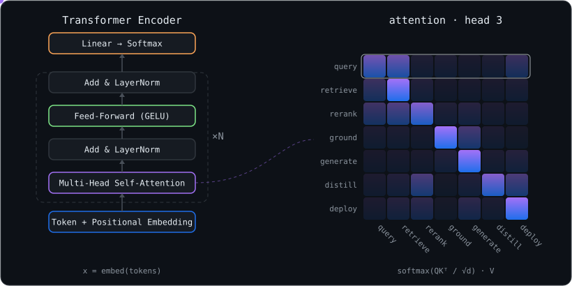

<b>Correspondence:</b> <a href="mailto:adityarai735@gmail.com">adityarai735@gmail.com</a> &nbsp;·&nbsp;
<a href="https://aditya-rai-portfolio-616843600343.asia-southeast1.run.app/">portfolio</a> &nbsp;·&nbsp;
<a href="https://linkedin.com/in/aditya-rai">linkedin</a>

---

### 1 &nbsp; Introduction

Most useful AI comes down to **finding the right thing**: the right passage for a question, the right track for a conversation, the right identity for a face or an ear. I am a B.Tech student in Artificial Intelligence & Machine Learning at NIT Kurukshetra (2023–2027, CGPA 8.85). I work on retrieval and RAG, and on making the models behind them small enough to run on edge devices.

The contributions of this profile are as follows:

1. **Cross-language math retrieval** (Hindi → English) with translation and ColBERT late interaction, placing in the top 6 at FIRE 2025 [P3].
2. **Cascaded distillation and structured pruning** that shrink an ear-recognition model by 91% while placing 2nd in both tracks of IEEE UERC 2026 [P2].
3. **Conversational music recommendation** that fuses CF, audio, visual and lexical retrieval with weighted RRF, at ACM RecSys 2026 [P1].
4. A citation-aware **medical RAG system** with hallucination guardrails (§4), plus open-source fixes to GPU and recommender-system libraries (§5).

I was also selected for **Amazon ML Summer School 2026**. Ask me about hybrid retrieval, reranking, knowledge distillation or model pruning.

### 2 &nbsp; Publications

**[P1]** *Dialogue-Aware Conversational Music Recommendation via Multi-Modal Retrieval and Weighted RRF.* ACM RecSys 2026, Music-CRS. 
**[P2]** *System Description: Cascaded Knowledge Distillation and Structured Pruning for Edge Ear Biometrics.* IJCB 2026, in press. 
**[P3]** *Enhancing Multilingual Mathematical Document Retrieval: A Hindi-to-English Translation and ColBERT-based Approach.* FIRE 2025, IIT (BHU) Varanasi.

### 3 &nbsp; Experiments

<b>Table 1.</b> Main results. Each row is a shared task, so the ranking is against other teams.

| Task | Method | Result | |
|---|---|---|:-:|
| **UERC 2026** edge ear biometrics | Multi-stage KD: SwinV2 88M → TinyViT 21M → **7.2M**, then Taylor pruning | **2nd, both tracks** · AUC 96.8% · 91% smaller | [P2] |
| **FIRE 2025 CLMIR** Hindi → English math IR | Query translation + ColBERT late-interaction retrieval | **Top 6** · MAP 0.148 · nDCG 0.220 | [P3] |
| **RecSys 2026 Music-CRS** conversational recsys | Multi-seed FAISS over CF / audio / visual embeddings + BM25, fused by weighted RRF, with an LLM exact-match extractor | **9th** academic · 25th overall · 47K-track catalog | [P1] |
| **Amazon ML Challenge 2026** | | **AIR 312** | |

### 4 &nbsp; Systems

<b>Table 2.</b> Selected implementations. All code is public.

| System | Description | Notes | Stack |
|---|---|---|---|
| [**QAMed**](https://github.com/this-AR/QAMED) | Citation-aware medical RAG over MBBS textbooks: hybrid BM25 + dense retrieval, CrossEncoder reranking, multi-hop routing, two-tier hallucination guardrails | 86%+ faithfulness · ~1s generation · Redis semantic cache | LLaMA-3.1, LangChain, Qdrant, PubMedBERT, Langfuse |
| [**sargam-music-crs**](https://github.com/this-AR/sargam-music-crs) | Code for [P1] | 9th academic track | FAISS, BM25, Gemini |
| [**neetcode-gpt**](https://github.com/this-AR/neetcode-gpt) | A GPT from scratch: gradient descent → self-attention → multi-head attention → transformer blocks → language model | no frameworks | Python, NumPy |
| [**AI_RESEARCHAGENT**](https://github.com/this-AR/AI_RESEARCHAGENT) | Four-agent pipeline: lead discovery → email generation → workflow review → quality validation | being rebuilt as an evidence-grounded app | CrewAI |
| [**eeg_stress_detection**](https://github.com/this-AR/eeg_stress_detection) | Replication and extension of a stress-detection paper on SAM40 EEG (40 subjects, 14 channels, 4s windows) | paper replication | scikit-learn, XGBoost, PyTorch |
| [**Music_genre_class**](https://github.com/this-AR/Music_genre_class) | An IEEE paper's modified CNN on MFCC features, GTZAN, 10 genres | 85.62% test accuracy | TensorFlow, Librosa |

  

<b>Figure 1.</b> A transformer encoder attending over the stages of my own work. <i>query → retrieve → rerank → ground → generate</i> is the <a href="https://github.com/this-AR/QAMED">QAMed</a> pipeline; <i>distill → deploy</i> is how the UERC model went from 88M to 7.2M parameters [P2]. The attention mechanism is the one built from scratch in <a href="https://github.com/this-AR/neetcode-gpt">neetcode-gpt</a>.

### 5 &nbsp; Related work

Upstream contributions. ● merged &nbsp; ○ open

- **[AlphaGPU/leetgpu-challenges](https://github.com/AlphaGPU/leetgpu-challenges)** ★ 1.2k · GPU programming challenges
  - ● [Make Top-p Sampling deterministic and reproducible](https://github.com/AlphaGPU/leetgpu-challenges/pull/374)
  - ● [Fix JAX reference crash in Speculative Decoding Verification](https://github.com/AlphaGPU/leetgpu-challenges/pull/368)
  - ● [Add challenge structure validator](https://github.com/AlphaGPU/leetgpu-challenges/pull/311)
  - ● [Fix stale `run_challenge.py` flag in docs](https://github.com/AlphaGPU/leetgpu-challenges/pull/367)
  - ○ [Replace the degenerate OLS performance test](https://github.com/AlphaGPU/leetgpu-challenges/pull/377)
  - ○ [Fix Count Array Element perf test range](https://github.com/AlphaGPU/leetgpu-challenges/pull/378)
- **[sb-ai-lab/RePlay](https://github.com/sb-ai-lab/RePlay)** ★ 417 · end-to-end recommender systems framework
  - ○ [Preserve tensor feature `padding_value` during serialization](https://github.com/sb-ai-lab/RePlay/pull/92)
- **[Venkatesh-Shukla/The_small_coder](https://github.com/Venkatesh-Shukla/The_small_coder)** collaborative ML project
  - ● [Add RAG implementation](https://github.com/Venkatesh-Shukla/The_small_coder/pull/5), plus 2 report PRs

### 6 &nbsp; Conclusion

Retrieval decides what a model gets to see, and compression decides where it gets to run. I want to keep working on both. If you are working on IR, RAG or efficient models, [write to me](mailto:adityarai735@gmail.com).

---

<b>Appendix A &nbsp; Toolbox</b>

 

| | |
|---|---|
| Languages | Python, Java |
| Deep learning | PyTorch, TensorFlow / Keras, Hugging Face, scikit-learn, XGBoost |
| Retrieval & LLMs | LangChain, CrewAI, Qdrant, FAISS, ColBERT, BM25, Langfuse |
| Serving & data | FastAPI, Streamlit, Redis, SQLite, Pandas, NumPy |
| Tools | Git, Linux, VS Code |

<b>Appendix B &nbsp; Other work</b>

 

- [**Deepphenotree-CVPPA**](https://github.com/this-AR/Deepphenotree-CVPPA): plant phenotyping for the CVPPA workshop
- [**neetcode-practice**](https://github.com/this-AR/neetcode-practice): NeetCode solutions in Java
- [**FIFA-Player-Analysis**](https://github.com/this-AR/FIFA-Player-Analysis) · [**Stock_analysis**](https://github.com/this-AR/Stock_analysis): data analysis notebooks

