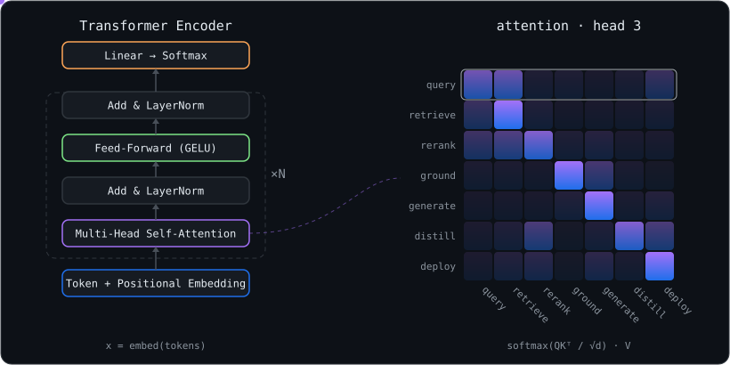

  
  
  
  

  

## 🧠 About me

I'm a B.Tech student in **Artificial Intelligence & Machine Learning at NIT Kurukshetra** (CGPA 8.85, 2023–2027). My research is about **finding things**: multilingual information retrieval, retrieval-augmented generation, and recommendation. I also work on **making deep models small enough to run on edge devices**.

- 🔬 Research intern at NIT Kurukshetra, building cross-language math retrieval (Top 6 at FIRE 2025)
- 🥈 2nd place in **both tracks** of the IEEE Unconstrained Ear Recognition Challenge 2026
- ☀️ Selected for **Amazon ML Summer School 2026**
- 💬 Ask me about RAG pipelines, hybrid retrieval, knowledge distillation, or model pruning

## 📄 Publications

| | Paper | Venue |
|:-:|---|---|
| 🎵 | **Dialogue-Aware Conversational Music Recommendation via Multi-Modal Retrieval and Weighted RRF** | ACM RecSys 2026 · Music-CRS |
| 👂 | **System Description: Cascaded Knowledge Distillation and Structured Pruning for Edge Ear Biometrics** | IJCB 2026 · *in press* |
| ➗ | **Enhancing Multilingual Mathematical Document Retrieval: A Hindi-to-English Translation and ColBERT-based Approach** | FIRE 2025 · IIT (BHU) Varanasi |

## 🔬 Research highlights

<table>
<tr>
<td width="50%" valign="top">

### 👂 UERC 2026: Edge Ear Biometrics
Multi-stage **knowledge distillation + Taylor pruning**: SwinV2 88M → TinyViT 21M → **7.2M** parameters, small enough for a Raspberry Pi 4.

`🥈 2nd place, both tracks` · `91% smaller` · `AUC 96.8%`

PyTorch · TinyViT · SwinV2 · AdaFace · torch-pruning · 📄 IJCB 2026

</td>
<td width="50%" valign="top">

### ➗ CLMIR: FIRE 2025
Cross-language **math retrieval** (Hindi → English): translation followed by ColBERT late-interaction retrieval.

`Top 6 teams` · `MAP 0.148` · `nDCG 0.220`

ColBERT · NLP · Multilingual IR · 📄 FIRE 2025

</td>
</tr>
</table>

## 🚀 Featured repos

<table>
<tr>
<td width="50%" valign="top">

### 🩺 [QAMed](https://github.com/this-AR/QAMED)
A citation-aware **medical RAG** system built on MBBS textbooks.
Hybrid BM25 + dense retrieval, CrossEncoder reranking, multi-hop routing, and two-tier hallucination guardrails.

`86%+ faithfulness` · `~1s generation` · `Redis + semantic cache`

LLaMA-3.1 · LangChain · Qdrant · PubMedBERT · Langfuse

</td>
<td width="50%" valign="top">

### 🎶 [Team Sargam: Music-CRS](https://github.com/this-AR/sargam-music-crs)
A conversational music recommender for the ACM RecSys 2026 challenge. Multi-seed FAISS search over CF, audio and visual embeddings, plus BM25, merged with weighted RRF and an LLM exact-match extractor.

`9th academic track` · `47K-track catalog` · `📄 RecSys 2026`

FAISS · BM25 · Gemini · RRF

</td>
</tr>
<tr>
<td width="50%" valign="top">

### 🧪 [neetcode-gpt](https://github.com/this-AR/neetcode-gpt)
A **GPT built from scratch**, starting from gradient descent and working up through self-attention, multi-head attention and transformer blocks to a working language model.

`attention from scratch` · `full GPT`

Python · NumPy

</td>
<td width="50%" valign="top">

### 🤖 [AI Research Agent](https://github.com/this-AR/AI_RESEARCHAGENT)
A **four-agent CrewAI pipeline**: lead discovery → email generation → workflow review → quality validation. It is being upgraded into an evidence-grounded app.

`multi-agent` · `LLM orchestration`

CrewAI · Python · LLMs

</td>
</tr>
<tr>
<td width="50%" valign="top">

### 🧠 [EEG Stress Detection](https://github.com/this-AR/eeg_stress_detection)
Replicates and extends a stress-detection paper on the **SAM40 EEG dataset** (40 subjects, 14 channels). Classifies 4-second windows as rest or stress, using band-pass filtering and per-subject normalisation.

`paper replication` · `biosignals`

scikit-learn · XGBoost · PyTorch · SciPy

</td>
<td width="50%" valign="top">

### 🎵 [Music Genre Classification](https://github.com/this-AR/Music_genre_class)
An IEEE paper's **modified CNN on MFCC features**, implemented on GTZAN across 10 genres.

`85.62% test accuracy` · `paper implementation`

TensorFlow · Keras · Librosa

</td>
</tr>
</table>

## 🌍 Open-source contributions

<table>
<tr>
<td width="50%" valign="top">

### ⚡ [AlphaGPU/leetgpu-challenges](https://github.com/AlphaGPU/leetgpu-challenges)
⭐ 1.2k · GPU programming challenges

- 🟣 [Make Top-p Sampling deterministic and reproducible](https://github.com/AlphaGPU/leetgpu-challenges/pull/374)
- 🟣 [Fix JAX reference crash in Speculative Decoding Verification](https://github.com/AlphaGPU/leetgpu-challenges/pull/368)
- 🟣 [Add challenge structure validator](https://github.com/AlphaGPU/leetgpu-challenges/pull/311)
- 🟣 [Fix stale `run_challenge.py` flag in docs](https://github.com/AlphaGPU/leetgpu-challenges/pull/367)
- 🟢 [Replace the degenerate OLS performance test](https://github.com/AlphaGPU/leetgpu-challenges/pull/377)
- 🟢 [Fix Count Array Element perf test range](https://github.com/AlphaGPU/leetgpu-challenges/pull/378)

</td>
<td width="50%" valign="top">

### 🎯 [sb-ai-lab/RePlay](https://github.com/sb-ai-lab/RePlay)
⭐ 417 · end-to-end recommender systems framework

- 🟢 [Preserve tensor feature `padding_value` during serialization](https://github.com/sb-ai-lab/RePlay/pull/92)

### 📘 [The_small_coder](https://github.com/Venkatesh-Shukla/The_small_coder)
Collaborative ML project

- 🟣 [Add RAG implementation](https://github.com/Venkatesh-Shukla/The_small_coder/pull/5) + 2 report PRs

</td>
</tr>
</table>

🟣 merged · 🟢 open

<b>More things I've built</b>

 

- 🌳 [**Deepphenotree-CVPPA**](https://github.com/this-AR/Deepphenotree-CVPPA): plant phenotyping for the CVPPA workshop
- ☕ [**neetcode-practice**](https://github.com/this-AR/neetcode-practice): my NeetCode problem solutions in Java
- 📊 [**FIFA-Player-Analysis**](https://github.com/this-AR/FIFA-Player-Analysis) · [**Stock_analysis**](https://github.com/this-AR/Stock_analysis): data analysis notebooks

## 🏆 Achievements

- 🥈 **2nd place, both tracks**: Unconstrained Ear Recognition Challenge (UERC 2026), IEEE Biometrics Council
- 🎵 **9th place (Academic Track), 25th overall**: ACM RecSys 2026 Music-CRS Challenge
- 🏅 **Top 6**: CLMIR track, FIRE 2025
- ☀️ **Selected**: Amazon ML Summer School 2026
- 📈 **AIR 312**: Amazon ML Challenge 2026

## 🛠️ Toolbox

  

  
  
  
  
  
  
  
  

## ⚡ Under the hood

  

  

The tokens in the heatmap are the stages of my own work: <b>query → retrieve → rerank → ground → generate</b> is the <a href="https://github.com/this-AR/QAMED">QAMed</a> RAG pipeline, and <b>distill → deploy</b> is how the UERC models got from 88M to 7.2M parameters for the edge. 
The attention it draws is the same mechanism I implemented from scratch in <a href="https://github.com/this-AR/neetcode-gpt">neetcode-gpt</a>.

